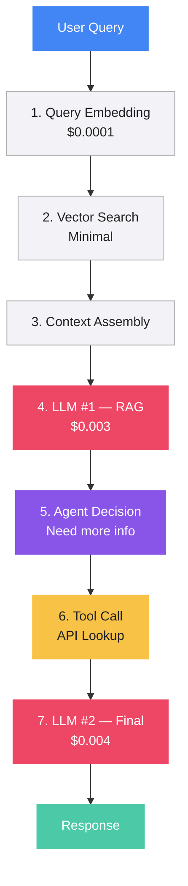
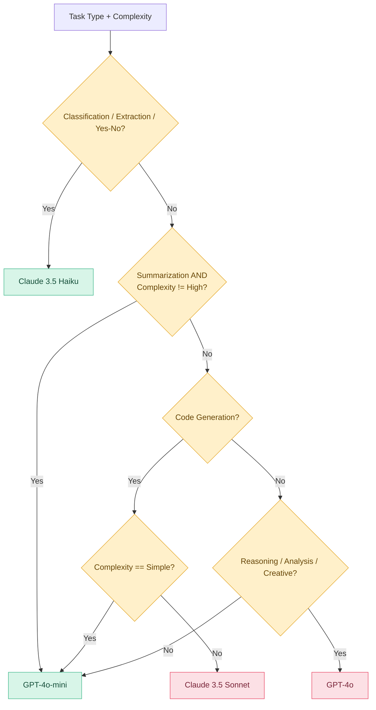
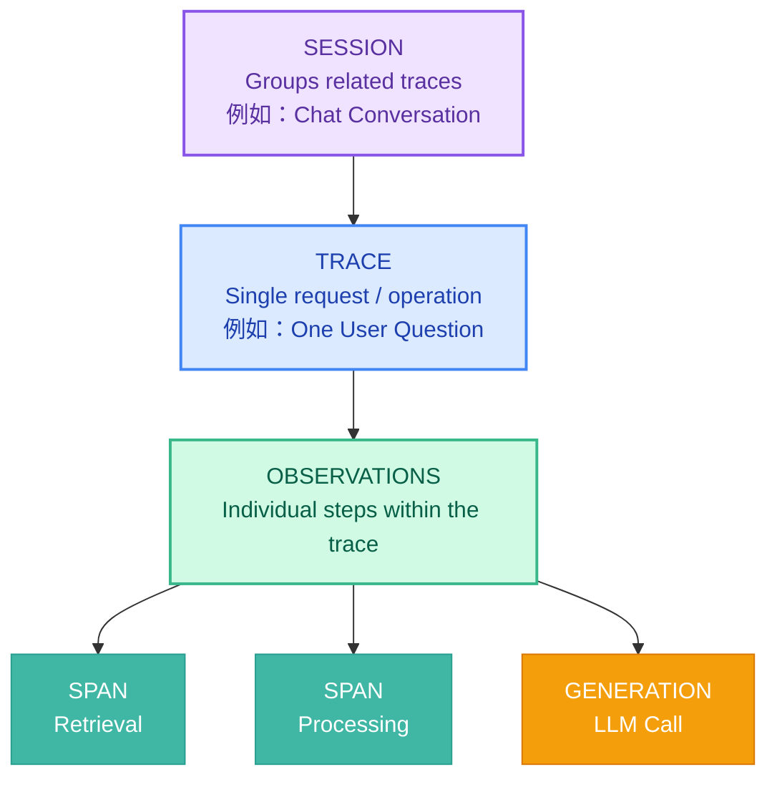
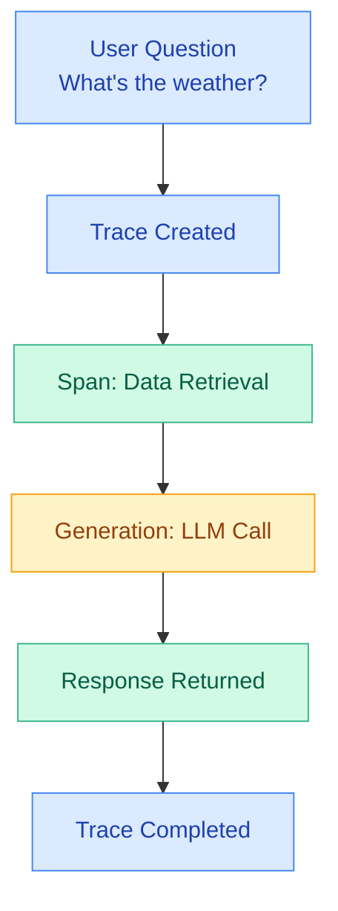
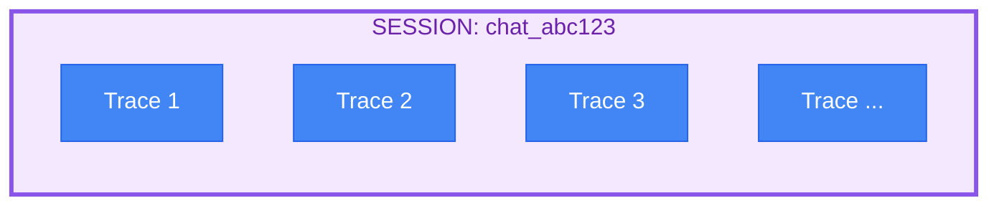
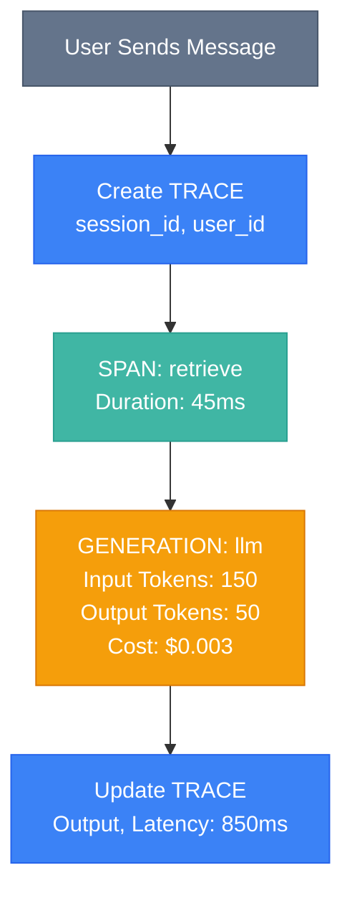
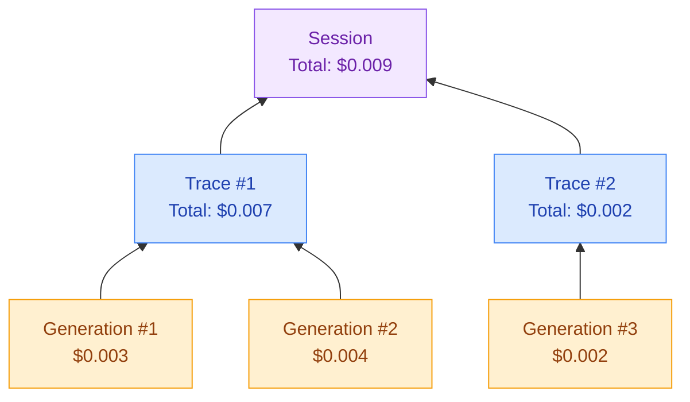
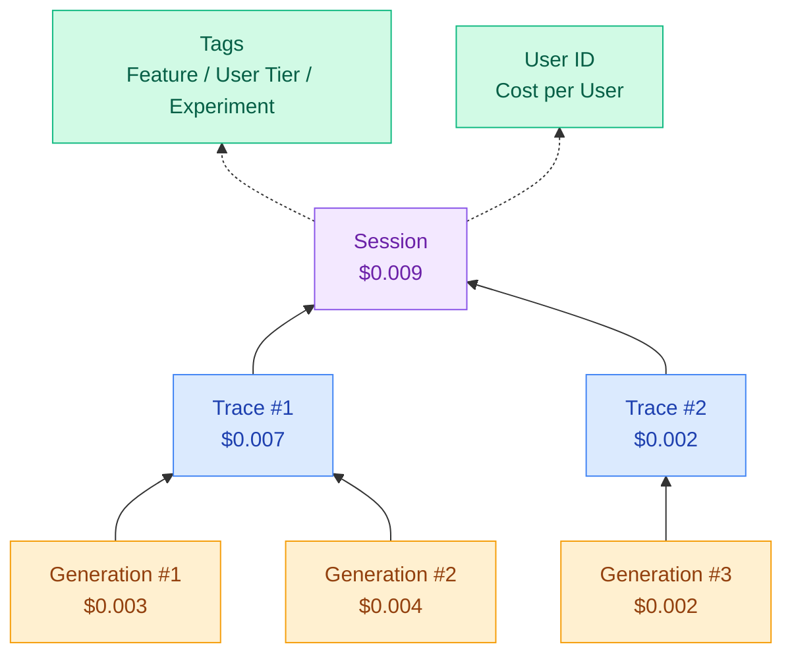

# Setup

```bash
git clone https://github.com/christseng89/llm-observability-course.git LangFuse
cd LangFuse

pyenv global 3.12.10
pyenv local 3.12.10

uv sync
```
---

# ROI Framework

Real cost comparison with Observability

| Category          | Without Obs. | With Obs. |
| ----------------- | ------------ | --------- |
| Monthly LLM spend | $35,000+     | $15,000   |
| Wasted retries    | $5,000+      | \~$0      |
| Debug time/week   | 20+ hours    | 2 hours   |
| Incident response | Days         | Same day  |

---

# Real Cost Breakdown

| Category     | Cost Components       |
| ------------ | --------------------- |
| 🔴 API Costs | Tokens                |
| 🟠 Compute   | Embeddings, Inference |
| 🟡 Debugging | Engineering Hours     |
| 🟢 Incidents | Downtime, Reputation  |

---

# The Cost Spiral

Token costs increased by 400%^

| Month | Cost |
| ----- | ---- |
| M1    | 1    |
| M2    | 1.75 |
| M3    | 2.6  |
| M4    | 5    |

M1–M4 values are illustrative; the source image does not provide exact monthly amounts.

> "Token costs grew 400% — we only found out at month end"

— Real quote from enterprise teams

Key takeaway: Without proper LLM observability, token consumption and API costs can increase significantly before teams detect the issue.

---
# Risk Matrix

Without observability

| Risk                    | Impact          | Probability  |
| ----------------------- | --------------- | ------------ |
| Token spike             | 🔴 High ($10K+) | 🔴 **Very High** |
| Silent failures         | 🟠 Medium       | 🔴 High      |
| Performance degradation | 🟠 Medium       | 🔴 High      |
| Compliance violation    | 🔴 **Critical**     | 🟠 Medium    |

## Without observability 四項風險

| Risk                       | 真實業務情境                              | 主要影響        | 建議監控                             |
| -------------------------- | ----------------------------------- | ----------- | -------------------------------- |
| 🔴 Token Spike             | AI Agent 重複呼叫 LLM，Token 暴增          | API 成本失控    | Token Usage、Cost、Retries         |
| 🟠 Silent Failures         | AI 遺漏 LC 文件不符點，但 API 回傳成功           | 業務損失、錯誤決策   | Output Validation、Business Rules |
| 🟡 Performance Degradation | Payment Investigation 從 5 秒增加至 30 秒 | 交易延遲、服務品質下降 | P95 Latency、Tool Duration        |
| 🔴 Compliance Violation    | 客戶敏感資料被記錄到未授權平台                     | 法規、財務、聲譽風險  | PII Detection、DLP、Audit Logs     |

---

# Traditional vs LLM Observability

# LLM Observability Areas

| LLM Observability Area | Description                                                     | Key Questions                                   |
| ---------------------- | --------------------------------------------------------------- | ----------------------------------------------- |
| Token Flows            | Monitor token usage and consumption across LLM requests         | How many input/output tokens? What's the ratio? |
| Model Behavior         | Track model responses, accuracy, and behavior                   | Is the LLM hallucinating（幻覺）?                   |
| Prompt Effectiveness   | Evaluate prompt quality and effectiveness                       | Is the prompt producing good results?           |
| Cost Attribution       | Track and attribute LLM costs to models, applications, or users | Which feature is consuming your budget?         |
| Retrieval Quality      | Evaluate the relevance and accuracy of retrieved information    | Is your RAG returning relevant chunks?          |

---

# Traditional vs LLM Observability

| Traditional Monitoring     | LLM Observability     |
| -------------------------- | --------------------- |
| Request → [???] → Response | Full trace visibility |
| Black box view             | Token flows tracked   |
| Only latency & errors      | Prompt effectiveness  |
| —                          | Cost attribution      |

---
# The Three Pillars for LLMs

| #    | Pillar      | Description                                 |
| ---- | ----------- | ------------------------------------------- |
| 🔴 1 | Traces      | End-to-end request flows through every step |
| 🟢 2 | Metrics     | Token usage, latency, costs per request     |
| 🔵 3 | Evaluations | Quality scores and output assessment        |

---

# What You'll Measure

- Token usage (input/output ratio)
- Latency (per step breakdown)
- Cost (per request, per feature, per user)
- Quality (relevance, hallucination rate)
- Errors (by type, by model, by prompt)

---

# ROI Calculator

## Current State (Without Observability)

| Category                     | Monthly Cost |
| ---------------------------- | ------------ |
| Monthly LLM spend            | $20,000      |
| Estimated waste (30%)        | $6,000       |
| Debug time (10 hr/wk × $100) | $4,000/mo    |
| Incident cost (amortized)    | $5,000/mo    |
| Total Preventable Cost       | $15,000/mo   |

### Investment

- Platform: $500–$2,000/month
- Setup: 8 hours one-time

## ROI (with Observability)

Estimated ROI => 7–30 times return in the first month alone

| 情境    | 每月節省    | 平台費用   | Return Multiple |
| ----- | ------- | ------ | --------------- |
| 高成本方案 | $15,000 | $2,000 | 7.5×            |
| 低成本方案 | $15,000 | $500   | 30×             |

### 正確計入第一個月的 Setup Cost

假設導入工程師成本沿用簡報的每小時 $100：

Setup Cost = 8 × $100 = $800。

| 項目                     | 低成本方案   | 高成本方案   |
| ---------------------- | ------- | ------- |
| Monthly Savings        | $15,000 | $15,000 |
| Platform Cost          | $500    | $2,000  |
| Setup Cost             | $800    | $800    |
| First Month Investment | $1,300  | $2,800  |
| Net Savings            | $13,700 | $12,200 |
| Benefit / Cost         | 11.54×  | 5.36×   |
| Net ROI                | 1,054%  | 436%    |

### Consecutive Monthly ROI (Month 2 Onward)

| Item                  | Low-Cost Plan | High-Cost Plan |
| --------------------- | ------------- | -------------- |
| Monthly Savings       | $15,000       | $15,000        |
| Monthly Platform Cost | $500          | $2,000         |
| Setup Cost            | $0            | $0             |
| Monthly Net Savings   | $14,500       | $13,000        |
| Benefit / Cost        | 30×           | 7.5×           |
| Monthly Net ROI       | 2,900%        | 650%           |

> Net ROI = Net Savings / First Month Investment * 100%

### Real Results

| Improvement            | Result | Description                 |
| ---------------------- | ------ | --------------------------- |
| Token cost reduction   | 47%    | From prompt optimization    |
| Less debug time        | 80%    | With proper tracing         |
| Runaway cost surprises | $0     | No unexpected runaway costs |

---

# LLM Token Economics

The basics of LLM pricing

- Token ≈ 4 characters in English
- Tokens ≠ characters ≠ words
- Output costs 2–5× more than input
- Code tokenizes inefficiently

---

# 2025–2026 Pricing Landscape

| Model             | Input / 1M Tokens | Output / 1M Tokens |
| ----------------- | ----------------- | ------------------ |
| GPT-4o            | $2.50             | $10.00             |
| GPT-4o-mini       | $0.15             | $0.60              |
| Claude 3.5 Sonnet | $3.00             | $15.00             |
| Claude 3.5 Haiku  | $0.25             | $1.25              |

Note: These are the prices shown in the image, not necessarily current API prices as of October 2026.

> Conciseness == Save money

---

# Hands on LLM cost

```bash
uv run tokens-demo-1.py
uv run token_calculator-2.py
```

---

# Where Costs Hide: RAG + Agent Pipeline

## 1. RAG + Agent Pipeline (Mermaid)



## 2. Cost Breakdown

| Step | Component              | Cost per Query |
| ---- | ---------------------- | -------------- |
| 1    | Query Embedding        | $0.0001        |
| 2    | Vector Search          | Minimal        |
| 3    | Context Assembly       | Not specified  |
| 4    | LLM #1 — RAG           | $0.003         |
| 5    | Agent Decision         | Not specified  |
| 6    | Tool Call (API Lookup) | Not specified  |
| 7    | LLM #2 — Final         | $0.004         |
|      | Total (Approx.)        | $0.007         |

The slide rounds the total to $0.007; the explicitly listed costs sum to $0.0071. Unspecified infrastructure or tool costs are not included.

## 3. Cost at Scale

| Metric                 | Cost     |
| ---------------------- | -------- |
| One User Query         | $0.007   |
| Queries per Day        | 100,000  |
| Daily Cost             | $700     |
| Monthly Cost (30 days) | $21,000  |
| Annual Cost (360 days) | $252,000 |

Assuming no retries, errors, or verbose responses.

## 4. Key Takeaway

> LLM calls are 95%+ of your cost.

In this example, the two LLM calls account for approximately 98.6% of the explicitly itemized $0.0071 per-query cost.

The exact percentage will depend on model pricing, token usage, retrieval infrastructure, tool/API charges, and the number of Agent iterations.

---
# LLM 成本的五大主要驅動因素（Top 5 Cost Drivers）

| #    | 成本驅動因素                             | 說明                                                      |
| ---- | ---------------------------------- | ------------------------------------------------------- |
| 🔴 1 | 過度膨脹的系統提示詞（Bloated System Prompts） | 每次 LLM 請求都會傳送過長的 System Prompt，造成大量重複的 Input Token 成本。  |
| 🟠 2 | 過量的 RAG 上下文（Excessive RAG Context） | RAG 檢索並傳入太多文件片段（Chunks），增加 Token 消耗，且更多內容不一定能提高回答品質。    |
| 🟡 3 | Agent 推理循環（Agent Reasoning Loops）  | AI Agent 反覆推理、呼叫工具或產生冗長的推理內容，增加 Token 使用量及 API 呼叫成本。    |
| 🟢 4 | 持續增長的對話歷史（Growing Chat History）    | 隨著對話增加，每次請求可能重新傳送更多歷史訊息，造成 Token 消耗持續上升。                |
| 🔵 5 | 錯誤的模型選擇（Wrong Model Selection）     | 簡單任務使用昂貴的大型模型，而非成本較低的小型模型；不同模型的價格差異可能高達 200 倍（依比較對象而定）。 |


### LLM 五大成本問題與優化方式

| 成本問題                                    | 優化方式                                                                                      |
| --------------------------------------- | ----------------------------------------------------------------------------------------- |
| 1. 系統提示詞過長（Bloated System Prompts）      | 提示詞優化（Prompt Optimization）、<br>提示詞快取（Prompt Caching）                                          |
| 2. RAG 上下文過多（Excessive RAG Context）     | Top-K 檢索（Top-K Retrieval）、<br>重新排序（Reranking）、<br>上下文過濾（Context Filtering）                        |
| 3. AI Agent 重複推理（Agent Reasoning Loops） | 最大迭代次數限制（Max Iterations）、<br>工具呼叫次數限制（Tool Call Limits）、<br>循環偵測（Loop Detection）                  |
| 4. 對話歷史持續增長（Growing Chat History）       | 對話摘要（Conversation Summarization）、<br>上下文裁剪（Context Trimming）                                  |
| 5. 選擇不適當的模型（Wrong Model Selection）      | 模型路由（Model Routing）、<br>小型語言模型（Small Language Models，SLM）、<br>依任務選擇模型（Task-Based Model Selection） |
核心概念： LLM 成本不只取決於模型的 Token 單價，更取決於 每次請求的 Token 數量、LLM 呼叫次數、Agent 執行步驟，以及模型選擇策略。

因此，導入 LLM Observability 的重要目的之一，就是找出這五種隱藏成本，並持續優化。

---
# The Hidden Multipliers（隱藏的成本倍增因素）

| #    | 成本倍增因素                                 | 中文說明                                           |
| ---- | -------------------------------------- | ---------------------------------------------- |
| 🔴 1 | System Prompts Sent with EVERY Request | 每次 LLM 請求都會傳送 System Prompt，導致重複的 Token 消耗與成本。 |
| 🟠 2 | RAG Context Can Be 1000s of Tokens     | RAG 檢索的上下文可能包含數千個 Tokens，增加每次 LLM 呼叫的成本。       |
| 🟡 3 | Retries = Paying Twice (or More)       | API 請求失敗或 Agent 重試，可能造成重複計費，甚至使成本增加數倍。         |
| 🟢 4 | Chat History Grows Linearly            | 對話歷史隨著互動次數增加而持續增長，每次重新傳送歷史內容都會增加 Token 消耗。     |

核心概念： 這四項因素會放大 LLM 的實際使用成本。即使單次 API 呼叫很便宜，當請求量增加時，重複的 Prompt、RAG Context、Retries 和 Chat History 都可能造成顯著的額外支出。
---
# The 200× Price Gap（200 倍價格差距）

Same prompt, 200× cost difference

- 相同的提示詞（Prompt），使用不同的 LLM 模型，成本可能相差高達 200 倍。
- 核心概念： 選擇適合任務的模型（Model Selection / Model Routing），可顯著降低 LLM API 成本，而不一定需要犧牲回答品質。

註：200 倍是簡報中的示例說法，實際價格差距取決於比較的模型、Token 類型及 API 定價。

---
# Task → Model Matrix（任務與模型選擇矩陣）

| Task Type（任務類型）           | Cheap Works?（低成本模型可行？） | Recommendation（建議模型） |
| ------------------------- | ---------------------- | -------------------- |
| Classification（分類）        | 🟢 Yes                 | Haiku / Mini         |
| Simple Extraction（簡單資料擷取） | 🟢 Yes                 | Haiku / Mini         |
| Complex Reasoning（複雜推理）   | 🔴 No                  | Sonnet / GPT-4o      |
| Code Generation（程式碼生成）    | 🟡 Depends             | Test Both（兩者都測試）     |

核心概念：Model Routing（模型路由）

根據任務的複雜程度，自動選擇適合的 LLM 模型，以降低成本，同時維持必要的品質。

- **簡單**任務： 優先使用**低成本**模型。
- **複雜**任務： 優先使用**推理能力較強**的模型。
- 程式碼生成： 根據實際測試結果選擇模型。

註：表格保留原始簡報的模型建議。實際選型應依模型版本、價格及任務評測結果決定；較便宜的模型也可能勝任部分複雜任務。
---

## Model Routing — Decision Table

| Rule | Task Type       | Complexity    | Selected Model        | Input Cost / 1M Tokens |
| ---- | --------------- | ------------- | --------------------- | ---------------------- |
| R1   | Classification  | Any           | Claude 3.5 Haiku      | $0.25                  |
| R2   | Extraction      | Any           | Claude 3.5 Haiku      | $0.25                  |
| R3   | Yes / No        | Any           | Claude 3.5 Haiku      | $0.25                  |
| R4   | Summarization   | Low / Medium  | GPT-4o-mini           | $0.15                  |
| R5   | Summarization   | High          | GPT-4o-mini (Default) | $0.15                  |
| R6   | Code Generation | Simple        | GPT-4o-mini           | $0.15                  |
| R7   | Code Generation | Medium / High | Claude 3.5 Sonnet     | $3.00                  |
| R8   | Reasoning       | Any           | GPT-4o                | $2.50                  |
| R9   | Analysis        | Any           | GPT-4o                | $2.50                  |
| R10  | Creative        | Any           | GPT-4o                | $2.50                  |
| R11  | Other / Unknown | Any           | GPT-4o-mini (Default) | $0.15                  |

### Decision Logic



### Important Observations

1. Complexity is ignored for Classification, Extraction, Yes/No, Reasoning, Analysis and Creative tasks.
2. High-complexity Summarization falls through to the default GPT-4o-mini model.
3. Unknown task types always use GPT-4o-mini.
4. This is static rule-based Model Routing, not dynamic routing based on actual response quality or evaluation scores.

Note: Model prices are taken from the original code example and are not verified as current API pricing.

### Model Selection = Highest-Leverage Cost Optimization

> 模型選擇是降低 LLM 成本最具槓桿效益的優化方式。

> 核心概念： 透過 Model Routing（模型路由），根據任務複雜程度、品質要求及成本，自動選擇最適合的 LLM 模型，在維持所需品質的同時，大幅降低 API 成本。

```python
def select_model(task_type: str, complexity: str) -> str:
    """Select the most cost-effective model for the task."""

    # Classification, extraction, simple Q&A
    if task_type in ["classification", "extraction", "yes_no"]:
        return "claude-3.5-haiku"  # $0.25/1M

    # Summarization - usually fine with cheaper models
    if task_type == "summarization" and complexity != "high":
        return "gpt-4o-mini"  # $0.15/1M

    # Code generation - start cheap, can upgrade
    if task_type == "code":
        if complexity == "simple":
            return "gpt-4o-mini"
        return "claude-3.5-sonnet"  # Best for code

    # Complex reasoning, analysis, creative
    if task_type in ["reasoning", "analysis", "creative"]:
        return "gpt-4o"  # $2.50/1M

    # Default to mid-tier
    return "gpt-4o-mini"
```
---
# The Observation Platform Landscape（LLM 可觀測性平台概覽）

40+ tools, but only 6 matter for production

超過 40 種工具，但簡報認為只有 6 種對正式生產環境（Production）特別重要。

| Platform（平台）  | Best For（最適合）                       | Open Source?（開源？） |
| ------------- | ----------------------------------- | ----------------- |
| **Langfuse**      | 希望掌握系統控制權的團隊（Teams wanting control） | 🟢 Yes            |
| LangSmith     | 使用 LangChain 的團隊（LangChain users）   | ⚫ No              |
| Arize Phoenix | 機器學習團隊、模型評估（ML teams, evaluation）   | 🟡 Partial        |
| Helicone      | LLM 成本追蹤（Cost tracking）             | ⚫ No              |

## Decision Matrix（LLM Observability 平台選擇決策矩陣）

| Your Situation（使用情境）                      | Recommendation（推薦平台） |
| ----------------------------------------- | -------------------- |
| 大量使用 LangChain（Using LangChain heavily）   | LangSmith            |
| 希望使用開源及自行部署（Want open source / self-host） | Langfuse             |
| 以成本追蹤為首要需求（Cost tracking is #1 priority）  | Helicone             |
| 使用多家 LLM 供應商（Multiple LLM providers）      | Portkey              |

> 核心概念： 根據企業的技術架構、部署需求及成本管理目標，選擇合適的 LLM Observability 平台。
> 實際選型還應考慮資料安全、合規、平台整合能力及總持有成本（TCO）。

## My Recommendation: Langfuse（推薦使用 Langfuse）

Concepts transfer to any platform（相關概念適用於其他平台）

| # | Advantage（優勢）                         | Description（中文說明）                                       |
| - | ------------------------------------- | ------------------------------------------------------- |
| 1 | Open Source & Self-Hosting（開源與自行部署）   | 可自行部署 Langfuse，掌握系統、資料及基礎設施的控制權。                        |
| 2 | Vendor-Neutral（不依賴特定供應商）              | 支援整合不同 LLM 供應商，避免被單一模型供應商綁定。                            |
| 3 | Full-Featured Observability（完整可觀測性功能） | 提供 Tracing（追蹤）、Metrics（指標監控）、Evaluations（品質評估）等功能。      |
| 4 | Generous Free Tier（免費方案）- **Cloud**      | 簡報指出每月提供 50,000 Observations 的免費額度，適合初期開發、測試及概念驗證（PoC）。 |

### 核心建議

> 對企業級 AI Agent / LLM 系統，Langfuse 值得優先作為 PoC 評估對象，特別是重視資料控制權、自行部署、多模型整合及成本管理的銀行環境。 
> 註：50,000 Observations/月為原始簡報數據 (https://langfuse.com/)，未核實是否仍適用於目前方案；自行部署也可能產生基礎設施及維護成本，且開源版本功能與商業版本可能不同。

---

# LangFuse Setup

- https://langfuse.com/ (cloud free 500k/month)
- https://github.com/langfuse/langfuse (self-host)

---
## Setup in Cloud

- New Organization => Organization name (langfuse-course) => Create => 
- New Project => Project Name (langfuse-course) => Create
- Create Neww API Key => .env
- Settings 

```bash
uv add langfuse
```

LangFuse => 
- Home => Traces (2 verify_connection)
- Tracing => verify_connection / test_generation

---

# The Langfuse Data Model（Langfuse 資料模型）

Langfuse 如何組織與管理 LLM 可觀測性（Observability）資料。

> 主要目的是透過結構化的資料模型，追蹤 AI Agent / LLM 的執行過程、Token 消耗、成本、效能及輸出品質。

---

# The Hierarchy（Langfuse 資料層級架構）

## 1. Langfuse Data Model




## 2. Hierarchy Description（資料層級說明）

| Level | Component          | Description（中文說明）   | Example                        |
| ----- | ------------------ | ------------------- | ------------------------------ |
| 1     | Session（會話）        | 將多個相關的 Traces 組合在一起 | 一次完整的 Chat Conversation        |
| 2     | Trace（追蹤）          | 記錄單次請求或操作的完整執行流程    | 使用者提出一個問題                      |
| 3     | Observations（觀測記錄） | 記錄 Trace 中的各個執行步驟   | Retrieval、Processing、LLM Calls |
| 4     | Span（執行區段）         | 記錄非 LLM 操作的處理過程     | Vector Search、Data Processing  |
| 4     | Generation（模型生成）   | 記錄 LLM 呼叫及相關資訊      | Prompt、Response、Tokens、Cost    |

## 3. 核心概念

Session → Trace → Observations（Span / Generation）

例如使用者在同一個 Session 提出 3 個問題，就可以形成 3 個 Traces；每個 Trace 又可以包含多個 Spans 和 Generations。

這樣便能追蹤每個問題的完整執行過程，分析 Token Usage、Latency、Cost、Errors 及 LLM Output Quality。

> 註：此圖為簡化的概念模型。實際上，Session 通常透過 Session ID 關聯多個 Traces；Observations 可以具有父子關係，形成巢狀執行樹，而不只是單一平面層級。

---

# Traces（追蹤記錄）

The container for everything that happens in a single request.

Trace 是記錄單次請求從開始到結束，所有執行步驟的完整追蹤容器。

## 1. Trace Example（追蹤範例）

User asks: "What's the weather?"（今天天氣如何？）

Trace 記錄以下完整過程：

- ✓ The question received — 接收到使用者問題
- ✓ Any retrieval that happened — 執行資料檢索（Retrieval）
- ✓ The LLM call — 呼叫 LLM 模型
- ✓ The response returned — 回傳最終回答

## 2. Key Properties（主要屬性）

| Property   | Description             | 中文說明                    |
| ---------- | ----------------------- | ----------------------- |
| Name       | What operation is this? | 操作名稱，例如 `weather_query` |
| Input      | What went in            | 輸入資料，例如使用者的 Prompt      |
| Output     | What came out           | 輸出資料，例如 LLM 的最終回答       |
| User ID    | Who made this request   | 發起請求的使用者識別碼             |
| Session ID | Which conversation      | 所屬對話或會話的識別碼             |
| Tags       | Labels for filtering    | 分類標籤，用於查詢、篩選與分析         |

## 3. Trace Execution Flow（執行流程）



> 核心概念： 一個 Trace 可以包含多個 Observations（例如 Spans 和 Generations），讓開發人員追蹤每個處理步驟、分析執行時間、Token Usage、API Costs，以及找出發生錯誤的位置。

---

# Three Types of Observations（三種觀測記錄類型）

| Type                | Description                 | Examples                                        | 中文說明                               |
| ------------------- | --------------------------- | ----------------------------------------------- | ---------------------------------- |
| 🟠 Generation（模型生成） | LLM API Calls               | Claude/GPT Completions、Token Counts、Model Costs | 記錄 LLM 模型呼叫、輸入與輸出 Token 數量及 API 成本 |
| 🟢 Span（執行區段）       | Any Operation with Duration | Database Queries、Retrieval Steps、Processing     | 記錄具有執行時間的操作，例如資料庫查詢、RAG 檢索與資料處理    |
| 🩷 Event（事件）        | Point-in-Time Occurrences   | Cache Hits、Errors、Milestones                    | 記錄特定時間點發生的事件，例如快取命中、錯誤或重要里程碑       |

## Key Insight（核心概念）

Observations can be nested hierarchically（觀測記錄可以形成多層巢狀結構）。

例如，一個 Generation 可以包含 Child Spans，而 Span 也可以包含 Child Events。

### Hierarchy Explanation

| Level | Parent     | Child      | Relationship                |
| ----- | ---------- | ---------- | --------------------------- |
| 1     | Trace      | Generation | 一個 Trace 可以包含 多個LLM Generation  |
| 2     | Generation | Span       | 一個Generation 可以包含多個 Child Spans |
| 3     | Span       | Event      | 一個Span 可以包含多個 Child Events      |


重點區別：

- Generation： LLM 做了什麼？消耗多少 Tokens？花了多少錢？
- Span： 系統執行了什麼操作？耗費多少時間？
- Event： 執行過程中發生了什麼重要事件？

這三種 Observations 結合後，可以完整追蹤 AI Agent 的執行過程，並協助分析 Performance、Cost、Errors 和 Model Behavior。

---

# Sessions（會話）

Group related traces together（將相關的 Traces 組合在一起）

Session 是 Langfuse 中用來管理多個相關 Traces 的邏輯群組，例如一次完整的 Chat Conversation（聊天對話）。

## 1. Session Hierarchy



Example: 10-message chat = 1 Session with 10 Traces

此範例假設每則訊息觸發一個獨立 Trace。實際數量取決於應用程式如何設定追蹤。

## 2. Why Sessions Matter（為什麼 Session 很重要？）

| # | Benefit                    | 中文說明                                        |
| - | -------------------------- | ------------------------------------------- |
| 1 | See Full Conversation Flow | 查看完整對話流程，了解多次請求之間的關聯                        |
| 2 | Analyze User Behavior      | 分析使用者行為，例如提問方式、互動頻率和使用模式                    |
| 3 | Track Conversation Metrics | 追蹤整個 Session 的 Token Usage、Cost、Latency 等指標 |
| 4 | A/B Test Approaches        | 比較不同 Prompt、模型或 AI Agent 策略的效果              |

## 3. Session vs. Trace vs. Observation

| Level | Component   | Description  | Example               |
| ----- | ----------- | ------------ | --------------------- |
| 1     | Session     | 一組相關的 Traces | 一次完整聊天對話              |
| 2     | Trace       | 一次完整請求或操作    | 一次 User Question      |
| 3     | Observation | Trace 內的執行記錄 | Generation、Span、Event |

核心概念：

- 1 Session → N Traces
- 1 Trace → N Observations
- 1 Trace → N LLM Generations

因此，Langfuse 可以從 Session（整體對話）→ Trace（單次請求）→ Observation（具體執行步驟），逐層分析 LLM 的使用行為、成本、效能及品質。

---

# How It All Connects（Langfuse 完整流程與成本追蹤）

## 1. Langfuse Execution Flow（執行流程）




## 2. Execution Details（執行步驟）

| Step | Component          | Description（中文說明）                 | Example                 |
| ---- | ------------------ | --------------------------------- | ----------------------- |
| 1    | User Sends Message | 使用者發送請求                           | User Question           |
| 2    | Create Trace       | 建立 Trace，記錄 Session ID、User ID    | `session_id`, `user_id` |
| 3    | Span: Retrieve     | 執行 RAG 檢索，記錄處理時間                  | 45ms                    |
| 4    | Generation: LLM    | 呼叫 LLM，記錄 Input/Output Tokens 及成本 | 150 / 50 Tokens，$0.003  |
| 5    | Update Trace       | 更新 Trace，保存最終輸出及總執行時間             | Latency: 850ms          |

## 3. Cost Tracking（成本追蹤層級）

| Level | Component  | Cost Tracking               | 中文說明             |
| ----- | ---------- | --------------------------- | ---------------- |
| 1     | Generation | Per LLM Call Cost           | 每次 LLM 呼叫的成本     |
| 2     | Trace      | Total Cost per Request      | 每筆請求的總成本         |
| 3     | Session    | Cost per Conversation       | 整個對話的累計成本        |
| 4     | Tags       | Cost by Feature / User Tier | 根據功能、使用者等級分類分析成本 |

## 4. Cost Aggregation（成本彙總）



### Cost Calculation Example

| Component     | Calculation     | Total Cost |
| ------------- | --------------- | ---------- |
| Trace #1      | $0.003 + $0.004 | $0.007     |
| Trace #2      | $0.002          | $0.002     |
| Session Total | $0.007 + $0.002 | $0.009     |

核心概念：

- Generation Cost：每次 LLM API Call 的成本。
- Trace Cost：同一請求內多次 LLM Calls 的累計成本。
- Session Cost：同一會話內多個 Traces 的累計成本。
- Tags：依照 Feature、User Tier 或 Application 分類分析成本。

注意：上述彙總以 LLM Generation 成本為例。若需要完整的 Total Cost of Ownership（TCO），還應另外計入 Embedding、Vector Database、Tool/API Calls、Infrastructure 等成本；同時避免重複計入父子 Observations 的成本。

---
# Why This Matters for Cost Management（為什麼這對成本管理很重要）

## Langfuse Cost Management — 五大核心功能

| #     | Cost Management Feature                  | Description（中文說明）                                              |
| ----- | ---------------------------------------- | -------------------------------------------------------------- |
| 💰 1  | Generation-Level Cost Tracking（模型呼叫成本追蹤） | 每次 LLM 呼叫都記錄 Token 使用量及計算成本，方便分析不同模型的使用費用。                     |
| 📊 2  | Trace-Level Cost Tracking（請求成本追蹤）        | 彙總單一 Trace 內所有 Generations 的成本，計算每次使用者請求的總 LLM 成本。             |
| 💬 3  | Session-Level Cost Tracking（會話成本追蹤）      | 彙總 Session 內所有 Traces 的成本，計算一次完整對話的成本，對聊天產品的收費定價特別重要。          |
| 🏷️ 4 | Tag-Based Cost Breakdown（標籤成本分類）         | 依照功能（Feature）、使用者等級（User Tier）、實驗版本（Experiment Variant）分類統計成本。 |
| 👤 5  | User-Level Cost Analysis（使用者成本分析）        | 透過 User ID 分析個別使用者的 Token 消耗和累計費用，識別成本最高的使用者。                  |

## Cost Aggregation（成本彙總架構）



## Key Takeaway（核心概念）

Langfuse 支援從單次 LLM Call 到整個 Conversation，再到不同功能及使用者的多層次成本分析。

- Generation → 每次模型呼叫花多少錢？
- Trace → 每筆使用者請求花多少錢？
- Session → 每次完整對話花多少錢？
- Tags → 哪個功能或實驗版本最昂貴？
- User ID → 哪些使用者消耗最多成本？

這可以協助企業找出高成本功能、優化 Model Routing、減少不必要的 Token 消耗，並制定更合理的 AI 服務定價。

> 註：上述金額為示例中的 LLM 成本。若要計算完整的營運成本，還需納入 Embedding、Vector Database、外部工具與基礎設施等費用；Tags 和 User ID 是成本分析維度，並非額外的成本層級。

---
