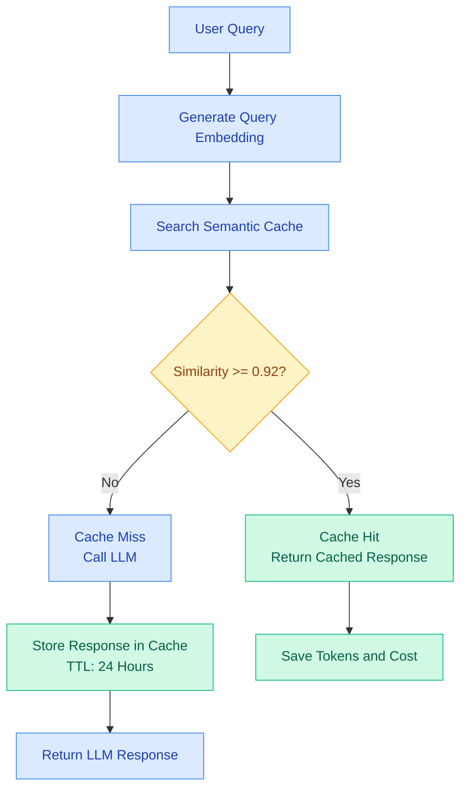

# Cost Optimization Strategies

## Techniques That Actually Work（實際有效的優化技術）

| # | Technique（技術）               | 中文說明                                                              |
| - | --------------------------- | ----------------------------------------------------------------- |
| 1 | Cost Reduction（成本降低）        | 透過優化 Token Usage、Prompt、RAG Context 及 LLM API Calls，降低整體 AI 運行成本。 |
| 2 | Smart Model **Routing**（智慧模型路由） | 根據任務複雜度、成本及品質要求，自動選擇最適合的 LLM 模型。                                  |
| 3 | Semantic **Caching**（語意快取）      | 利用語意相似度辨識相近問題，重複使用已有的回答，減少不必要的 LLM Calls。                         |

核心概念： 透過 Cost Reduction + Smart Model Routing + Semantic Caching 三種技術，在維持 AI 回答品質的前提下，降低 Token 消耗、API 成本及回應延遲。

---
# Cost Optimization Summary（LLM 成本優化總結）

| Strategy（優化策略）             | Savings（成本節省） | Effort（實施難度） |
| -------------------------- | ------------- | ------------ |
| Prompt Optimization（提示詞優化） | 🟢 30–50%     | Low（低）       |
| Semantic Caching（語意快取）     | 🟢 30–50%     | Medium（中）    |
| Model Routing（模型路由）        | 🟢 50–70%     | Medium（中）    |
| Combined（組合優化）             | 🔴 70–85%     | Medium（中）    |

### Key Takeaway（核心概念）

透過三種 LLM 成本優化技術：

- Prompt Optimization： 減少不必要的 Prompt Tokens 及 Context Size。
- Semantic Caching： 重複利用語意相似問題的回答，降低 LLM API 呼叫次數。
- Model Routing： 根據任務複雜度選擇適當模型，避免不必要的高成本模型呼叫。

Combined Optimization（組合優化）：簡報估計可降低 70–85% 的 LLM 成本。

注意：以上百分比為原始簡報的估計值，並非保證節省幅度。各項節省不能直接相加，實際效益需透過 Langfuse 的 Token Usage、Cost per Trace、Cache Hit Rate 及 Evaluation Quality 進行驗證。

---
# Implementation Priority（LLM 成本優化實施優先級）

| Priority（優先級） | Implementation Strategy（實施策略）                 | 中文說明                                                             |
| ------------- | --------------------------------------------- | ---------------------------------------------------------------- |
| 🔴 1          | Prompt Optimization（提示詞優化）                    | 優先優化 Prompt，減少不必要的 Token 消耗，基本上無需額外基礎設施成本。                       |
| 🟠 2          | Caching for Common Queries（常見查詢快取）            | 對常見或重複的查詢建立快取機制，減少重複的 LLM API Calls。                             |
| 🟡 3          | Model Routing for Mixed Workloads（混合工作負載模型路由） | 根據不同任務的複雜度，自動選擇適合的 LLM 模型，降低整體推論成本。                              |
| 🟢 4          | Continuous Monitoring & Iteration（持續監控與優化）    | 透過 Langfuse 持續監控 Token Usage、Cost、Latency 及 Quality，並根據分析結果反覆優化。 |

核心概念： 先從低成本、容易實施的 Prompt Optimization 開始，再逐步導入 Caching → Model Routing → Continuous Monitoring，持續降低 LLM 成本，同時維持回答品質。

---

# Prompt Optimization（提示詞優化）

透過簡化 System Prompt，刪除重複及不必要的指令，降低 LLM Input Token Usage（輸入 Token 消耗）。

## Before vs. After

| Item            | Before（優化前）                       | After（優化後）                  |
| --------------- | --------------------------------- | --------------------------- |
| Token Usage     | 89 Tokens                         | 13 Tokens                   |
| Prompt          | You are a helpful AI assistant... | You're a helpful assistant. |
|                 | Please note that...               | Be accurate and concise.    |
|                 | In your response, make sure to... |                             |
|                 | As an AI assistant...             |                             |


## Token Reduction

85.4% Token Reduction

計算公式： => (89-13) / 89 * 100% = 85.4%

| Item            | Before    | After     |
| --------------- | --------- | --------- |
| Token Usage     | 89 Tokens | 13 Tokens |
| Token Reduction | —         | 85.4%     |

## Key Takeaway（核心概念）

Prompt Optimization 是最容易實施、成本最低的 LLM 優化方式之一。

- 刪除重複的 System Instructions。
- 簡化不必要的敘述。
- 保留重要的 Business Rules、Output Format 和 Safety Constraints。
- 使用 Langfuse 比較優化前後的 Token Usage、Cost、Latency 和 Answer Quality。

注意： 85% 指的是此範例的 Prompt Token 減少比例，不代表整體 LLM API Cost 一定降低 85%。實際節省取決於完整輸入、輸出 Token、快取折扣及模型定價。

---
# Semantic Caching（語意快取）

核心概念： 不只匹配完全相同的問題，也能透過語意相似度（Semantic Similarity）識別意思相近的查詢，直接重複使用已快取的回答，降低 LLM API Calls、Token Cost 及 Response Latency。

### Example（範例）

> "What's your return policy?" ≈ "How do I return something?"

兩個問題的文字不同，但語意相近，因此可能共用快取結果。

## Key Features（主要特性）

| # | Feature                               | Description（中文說明）                  |
| - | ------------------------------------- | ---------------------------------- |
| 1 | Semantic Similarity Matching（語意相似度匹配） | 比對語意相近的查詢，而不只是完全相同的文字。             |
| 2 | Cache Hit Rate（快取命中率）                 | 簡報指出 Production 環境的快取命中率約為 30–50%。 |
| 3 | Similarity Threshold（相似度門檻）           | 簡報建議使用 0.92 作為語意相似度門檻。             |
| 4 | TTL — Time to Live（快取有效期限）            | 簡報建議多數應用情境使用 24 小時 TTL，到期後重新產生結果。  |

## Semantic Caching Flow



### Key Takeaway（核心概念）

Semantic Caching 可以降低重複查詢的 LLM 成本，但必須考慮回答的正確性與資料時效性。

尤其在銀行 Trade Finance、Payments、SSI 等業務中，不能僅依語意相似度重用答案。涉及客戶資料、交易狀態、LC Balance 或 Settlement Routing 的查詢，還需要檢查使用者權限、資料版本及業務上下文。

註：30–50% 命中率、0.92 門檻與 24 小時 TTL 是簡報中的參考值，並非所有系統通用的最佳設定。實際應透過測試與 Langfuse Evaluation 驗證。

---

# Prompt Optimization（提示詞優化）

```bash
uv run prompt_optimazation.py
```

## Technical Skills for Filtering（提示詞精簡技巧）

Manual Review is the Best Approach（人工審查是最佳方法）

透過人工審查 System Prompt，刪除不必要、重複或無實際作用的內容，以減少 Token Usage，同時維持 LLM 回答品質。

### Killer Questions（四個關鍵問題）

| # | Key Question                             | 中文說明                 |
| - | ---------------------------------------- | -------------------- |
| 1 | Does the Model Need This?                | 模型真的需要這段指令或資訊嗎？      |
| 2 | Can I Simplify?                          | 能否用更簡短、清晰的方式表達相同意思？  |
| 3 | Any Repetitions?                         | 是否存在重複或語意相近的指令？      |
| 4 | Is the Model Actually Going to Use This? | 模型在執行任務時，真的會使用這些資訊嗎？ |

### Key Takeaway（核心概念）

Prompt Optimization = Remove Unnecessary Tokens Without Sacrificing Quality.

提示詞優化的目的不是單純縮短 Prompt，而是移除沒有實際價值的內容，同時保留必要的 Business Rules、Context、Output Format 與 Safety Constraints。

建議使用 Langfuse 比較優化前後的 Token Usage、Cost、Latency 及 Evaluation Scores，確保節省成本的同時不降低回答品質。

---

# Semantic Caching（語意快取）

匹配語意相似的查詢，而不只是完全相同的問題。

例如：

- 問題 1：「你們的退貨政策是什麼？」（What's your return policy?）
- 問題 2：「我要如何退貨？」（How do I return something?）

| 項目                           | 說明                                   |
| ---------------------------- | ------------------------------------ |
| 語意相似（Semantic Similarity）    | 雖然文字不同，但使用者的意圖相近。                    |
| 重複使用快取答案（Same Cached Answer） | 如果快取答案適用，就直接回傳，不需要再次呼叫 LLM。          |
| 主要效益（Key Benefits）           | 減少 LLM API 呼叫次數、降低 Token 成本，並縮短回應時間。 |

核心概念： Semantic Caching 透過比較問題的語意，而非單純比對文字，重複使用適合的快取答案，避免不必要的 LLM 呼叫。

注意： 語意相似不代表答案一定相同。必須確認快取答案適用於目前的問題及業務情境。

```bash
# Cache
uv run semantic_cache.py 
uv run semantic_cache.py # Twice

# Routing
uv run model_routing.py
```
---
